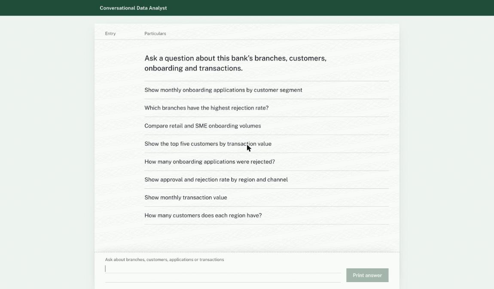
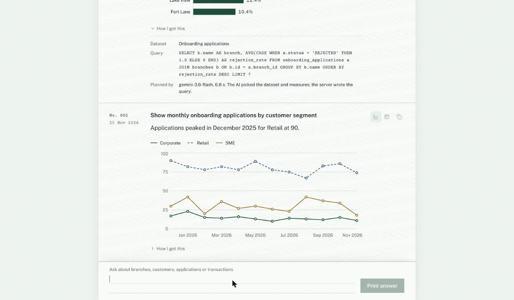
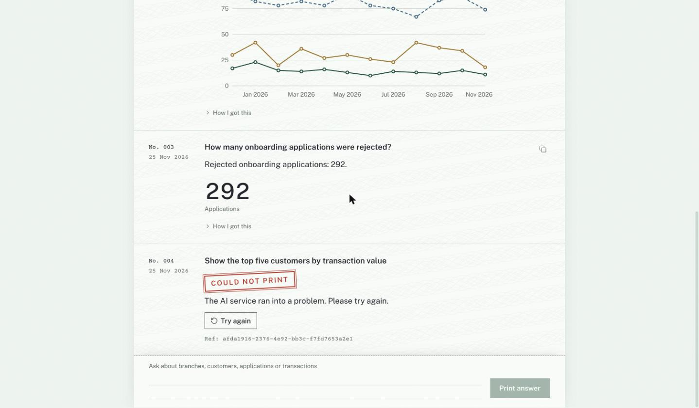
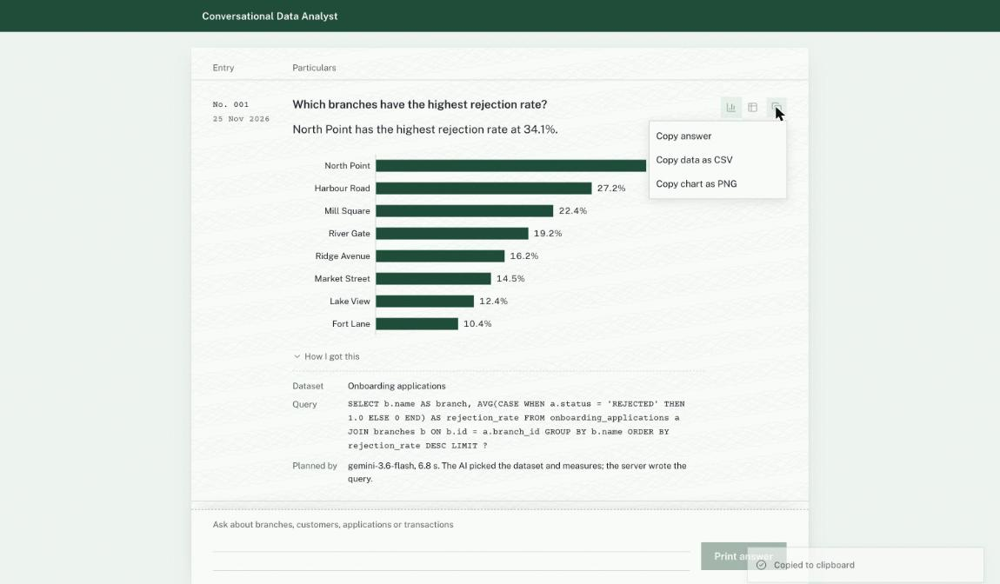
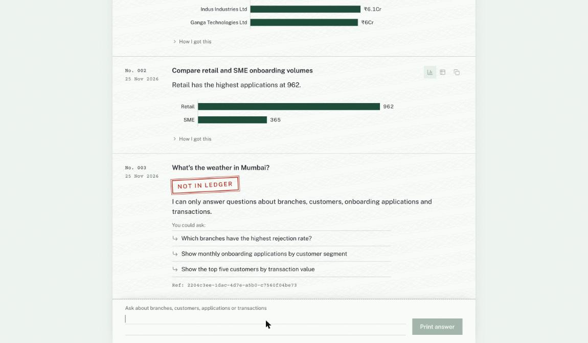
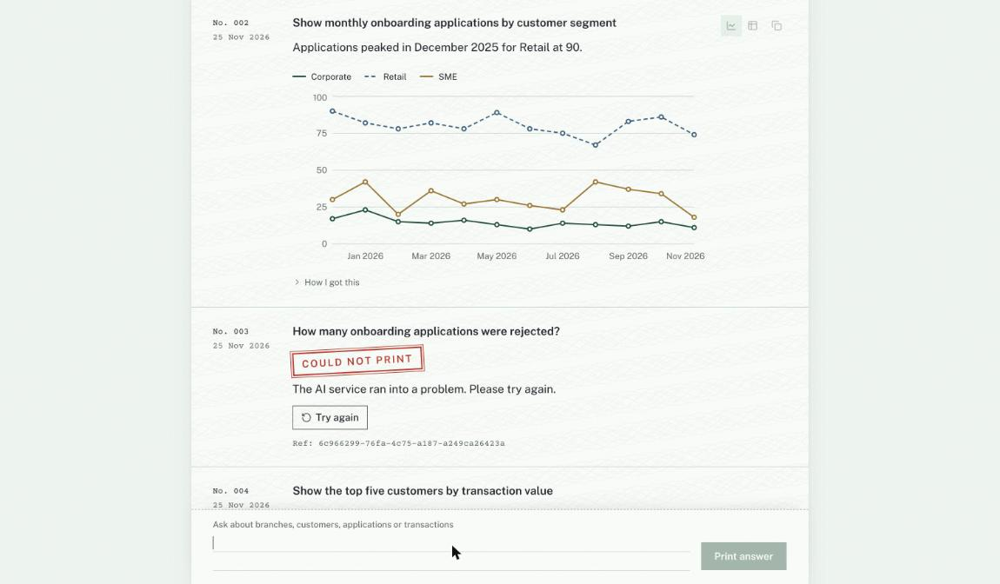
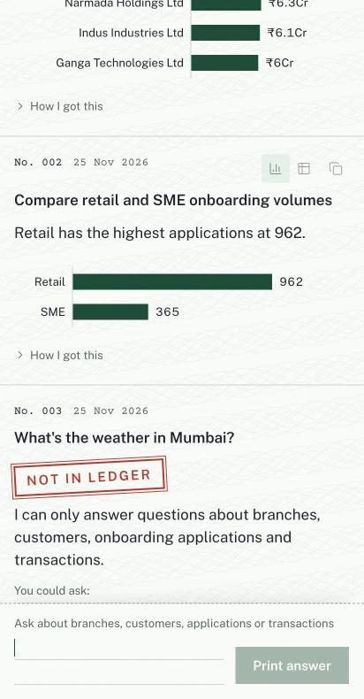
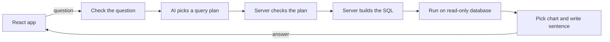

# Conversational Data Analyst

Ask a question about a bank's data in plain English. Get back a sentence plus a number, table, bar chart, or line chart, worked out by querying the database, not guessed by the AI. The data is made-up sample banking data in INR: branches, customers, onboarding applications, and transactions.


The AI never writes SQL. It only picks from a fixed list of datasets and measures, and the server writes the query. Full design: [docs/SPEC.md](docs/SPEC.md). API contract: [docs/API.md](docs/API.md).

## Quick start

You need Node 26 (see `.nvmrc`) and an API key: Gemini from [Google AI Studio](https://aistudio.google.com/) or OpenAI from [platform.openai.com](https://platform.openai.com/).

```sh
npm install
cp .env.example .env     # then set GEMINI_API_KEY, or AI_PROVIDER=openai and OPENAI_API_KEY
npm run db:seed          # creates server/data/bank.db
npm run dev              # API on :3001, app on http://localhost:5173
```

| Setting          | Default      | What it does                                                                            |
| ---------------- | ------------ | --------------------------------------------------------------------------------------- |
| `AI_PROVIDER`    | `google`     | `google` (Gemini), `openai`, or `mock` (example questions only, no key or network).     |
| `AI_MODEL`       | per provider | Empty means `gemini-4-hydrogen` or `gpt-5.4-mini`. Any model id of that provider works. |
| `GEMINI_API_KEY` | none         | Needed for `google`. Stays on the server.                                               |
| `OPENAI_API_KEY` | none         | Needed for `openai`. Stays on the server.                                               |

The other settings (port, database path, allowed origin) are in `.env.example`.

**If questions fail with "AI service" errors**, change the model or provider. During the build, `gemini-4-hydrogen` returned "high demand" (503) on almost every call, and the free tier allows only about 20 requests a day per model. `AI_MODEL=gemini-3.5-flash` worked until its daily limit. `AI_PROVIDER=openai` with `gpt-5.4-mini` answered every test question in 3–4 s.

Other commands: `npm test`, `npm run typecheck`, `npm run lint`, `npm run build`. CI runs all of them, plus a format check, on every push.

## How to use it

### Step 1: pick an example or type your own

Press Enter to send.



### Step 2: watch the entry fill in

Each question becomes a numbered, dated entry, like a line in a bank passbook. A thin bar moves while the server works.


### Step 3: see how the answer was found

Open **How I got this** to see the dataset and the exact SQL that ran.


## What answers look like

The shape of the result picks the visual: one number shows as a big figure, a breakdown by month as a line chart, one other breakdown as a bar chart, and anything else as a table. The icons on each entry switch between chart and table.

| Bar chart (amounts in INR)                                  | Line chart by month                               |
| ----------------------------------------------------------- | ------------------------------------------------- |
|  |  |

| Single figure                                 | Table view                                        |
| --------------------------------------------- | ------------------------------------------------- |
|  |  |

The copy icon copies the sentence, the data as CSV, or the chart as a PNG image.



## When it can't answer

A question outside the bank data gets a **NOT IN LEDGER** stamp and three questions to try instead. A technical failure gets **COULD NOT PRINT** and a **Try again** button. The `Ref:` code matches a line in the server log.

| Off-topic question                                        | AI or server failure                                             |
| --------------------------------------------------------- | ---------------------------------------------------------------- |
|  |  |

On a phone the layout stacks and charts use the full width.



## Architecture



The React app (`client/`) sends the question to the Express server (`server/`). Both import the same request, reply and query-plan types from `shared/`, so they can't drift apart. The server then:

1. Checks the question is 1–500 characters of text.
2. Asks the AI for a **query plan**: a small piece of JSON naming a dataset, a measure (such as "rejection rate") and a breakdown (such as "branch"), all picked from a fixed list.
3. Checks the plan's shape and every name in it against that list, called the **catalog** (`server/src/catalog/catalog.ts`). The catalog is an allow-list: unknown names, filter values, or dates are rejected.
4. Builds the SQL from pieces stored in the catalog. User values go in as `?` placeholders, never pasted into the SQL text.
5. Runs it on a **read-only** database connection, so the query can't change data.
6. Picks the chart from the shape of the result and writes the sentence from a template, with no AI.

## Tech choices and why

| Part                  | Choice                                        | Why                                                                                                         |
| --------------------- | --------------------------------------------- | ----------------------------------------------------------------------------------------------------------- |
| How AI meets the DB   | AI returns a query plan, never SQL            | A plan can be checked against a list. A prompt-injection attack at worst gives a plan that fails the check. |
| Safety list           | Hand-written catalog of datasets and measures | The AI picks names; the server owns every piece of SQL.                                                     |
| Answer text and chart | Templates, no AI                              | The AI can't invent a number.                                                                               |
| Database              | SQLite with a seed script                     | One file, nothing to install, set up with one command.                                                      |
| AI                    | Vercel AI SDK with Gemini or OpenAI           | Change model with one setting. A built-in mock lets tests run with no key.                                  |
| Checks and types      | Zod schemas in `shared/`                      | One schema gives both the runtime check and the TypeScript type.                                            |
| Frontend / backend    | React 19 + Vite, Express                      | Little setup, and Express routes are easy to test end to end with `supertest`.                              |
| Charts and UI parts   | Recharts, shadcn/ui, Tailwind                 | Charts are SVG, which copy-as-PNG needs. UI parts are accessible and easy to restyle.                       |
| Look                  | Bank passbook                                 | Branch staff already read passbooks: date on the left, details, then the figure.                            |
| AI timeout            | 30 s, one retry                               | Free-tier Gemini often takes 15–20 s or says it's busy.                                                     |

Considered and rejected:

- **AI writes SQL, then a checker reviews it.** More flexible, but much harder to prove safe or test.
- **PostgreSQL in Docker.** Closer to production, but setup costs too much time in a 60-minute build.
- **A second AI call to write the answer sentence.** It could make up numbers.

## Errors and security

- Every error goes out in one shape, `{ ok: false, error: { code, message, requestId } }`. Stack traces, SQL errors, and AI messages go to the server log only.
- `helmet` sets safe browser headers.
- CORS allows only the app's own address.
- Requests are capped at 10 KB, and each IP can ask 20 questions a minute.
- Results are capped at 100 rows.

## Assumptions

- Each question stands alone; earlier answers aren't used as context.
- All data is made up. No real bank, customer, or logo appears.
- All amounts are in INR.
- Rejection rate = rejected ÷ all applications, pending ones included.
- "Last 12 months" counts back from today, so the seeded dates move with the current date.

## Completed functionality

Checked against the brief in [docs/problem-statement.md](docs/problem-statement.md):

- [x] Chat-style interface with example questions
- [x] Natural-language question (1–500 characters)
- [x] Picks the dataset (AI query plan)
- [x] Builds the query on the server from the checked plan
- [x] Runs it on a relational database (SQLite)
- [x] Answer as text, KPI card, table, bar chart, or line chart
- [x] Copy text, CSV, or chart PNG
- [x] Clear messages for off-topic questions, bad input, and errors
- [x] Sample data with three datasets: customers and branches (200 and 8), 1,500 onboarding applications, 5,000 transactions
- [x] AI plans checked against the catalog; the AI never writes SQL
- [x] 121 automated tests, including SQL building, an injection attempt, the `/ask` endpoint end to end, and AI retries

## Known limitations

- Only questions the catalog covers get answers. Others are refused, not guessed.
- No follow-up questions, login, or saved history; entries live in the browser tab only.
- SQLite and an in-memory rate limit suit one server only.
- Free-tier Gemini can be slow; with the retry, the worst answer takes about a minute.
- The JavaScript bundle is 965 kB (287 kB gzipped), mostly the chart library.

## Productionising

- PostgreSQL with a read-only role and a query time limit.
- Login, per-user rate limits, and a shared rate-limit store such as Redis.
- Catalog in config, so analysts add measures without a deploy.
- Cache plans for repeated questions; paid Gemini tier or a second provider for steady speed.
- Send the JSON logs to a log store, with alerts on AI speed, cost, and errors.
- A test set of questions and expected plans, run in CI, to catch prompt or model changes.
- Split the chart library into its own chunk, build `shared/` with TypeScript project references, and run in Docker.

## AI tools used and my decisions

Built with **Claude Code**. The lead session wrote the API contract in `shared/` and `docs/API.md`, then two sub-agents built the backend and frontend in parallel against it. The lead session merged their work, tested it end to end in Chrome, fixed what turned up, and wrote this README.

I made every choice in [Tech choices and why](#tech-choices-and-why) myself. All but the AI timeout were written down in [docs/SPEC.md](docs/SPEC.md) (§1 and §14) before the build. During the build I chose the 30 s timeout with one retry, the `GEMINI_API_KEY` name, the switch to a flash model when Hydrogen was overloaded, and adding OpenAI as a second provider.
