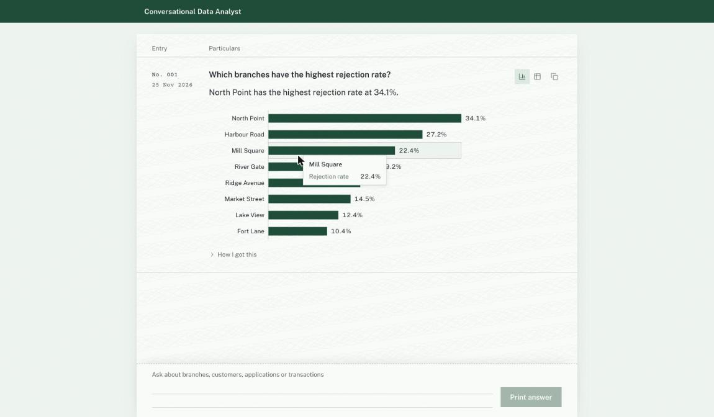
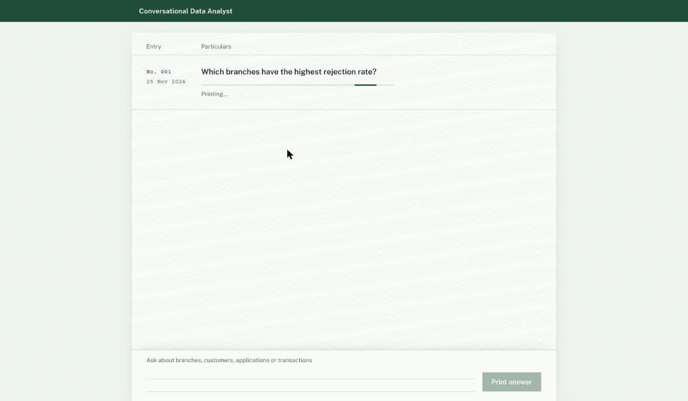
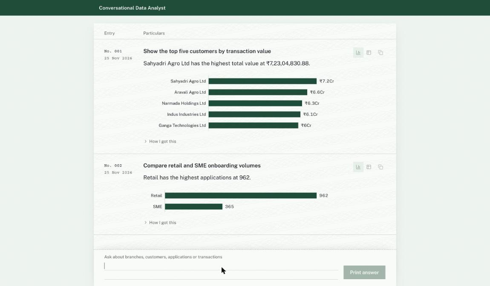
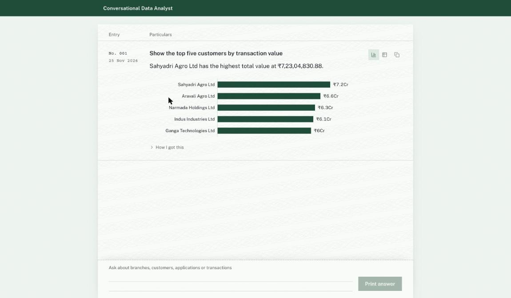
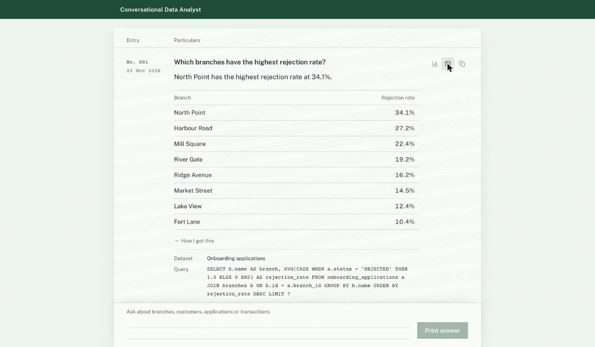
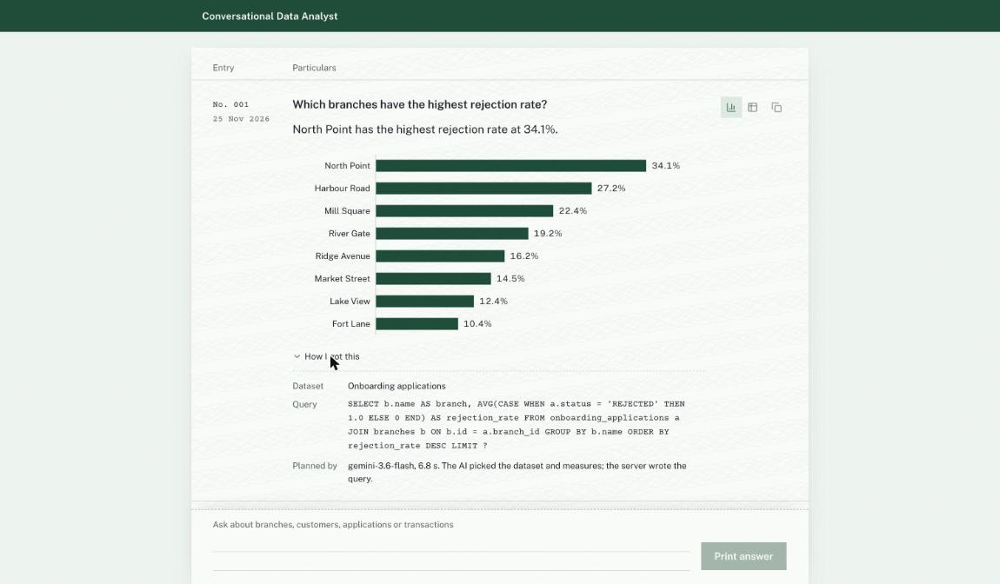
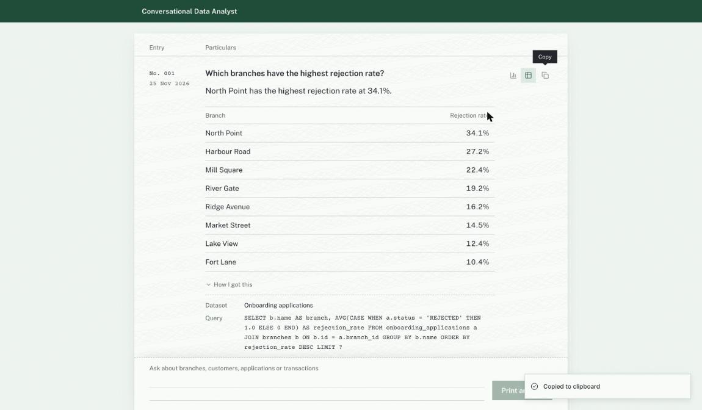

# Conversational Data Analyst

Ask a business question about a bank in plain English and get an answer worked out from real database rows. The answer comes as a sentence, a single figure, a table, a bar chart or a line chart. The data is synthetic sample banking data (branches, customers, onboarding applications and transactions, in INR).



The AI never writes SQL. It picks a dataset, measures and breakdowns from a fixed list; the server checks that choice and builds the query itself. Design details are in [docs/SPEC.md](docs/SPEC.md), and the API contract is in [docs/API.md](docs/API.md).

## Setup

You need Node 26 (see `.nvmrc`) and a Gemini API key from [Google AI Studio](https://aistudio.google.com/).

```sh
npm install
cp .env.example .env     # then set GEMINI_API_KEY in .env
npm run db:seed          # creates server/data/bank.db
npm run dev              # API on http://localhost:3001, app on http://localhost:5173
```

Open http://localhost:5173.

Settings in `.env`:

| Variable         | Default                 | What it does                                                          |
| ---------------- | ----------------------- | --------------------------------------------------------------------- |
| `GEMINI_API_KEY` | none                    | Required when `AI_PROVIDER=google`. Stays on the server.              |
| `AI_PROVIDER`    | `google`                | `google` for Gemini, `mock` for keyword rules with no key or network. |
| `AI_MODEL`       | `gemini-4-hydrogen`     | Any Gemini model id. See the note below.                              |
| `DATABASE_PATH`  | `./data/bank.db`        | SQLite file, relative to `server/`.                                   |
| `PORT`           | `3001`                  | API port.                                                             |
| `CLIENT_ORIGIN`  | `http://localhost:5173` | The only origin CORS allows.                                          |

**Model note.** During the build, `gemini-4-hydrogen` returned "high demand" (503) on every call. The local `.env` used `gemini-3.6-flash` and then `gemini-3.5-flash`; both pick correct plans. On the free tier each model allows about 20 requests a day, so set `AI_MODEL` to another flash model if you hit the daily limit. To try the app without a key, set `AI_PROVIDER=mock`. It answers the example questions only.

## Scripts

| Command                | What it does                                   |
| ---------------------- | ---------------------------------------------- |
| `npm run dev`          | API and app together                           |
| `npm run db:seed`      | Rebuild the sample database (same data always) |
| `npm test`             | Vitest for server and client (121 tests)       |
| `npm run typecheck`    | `tsc --noEmit` in every workspace              |
| `npm run lint`         | ESLint                                         |
| `npm run format:check` | Prettier, check only                           |
| `npm run build`        | Production build of the app                    |

CI (`.github/workflows/ci.yml`) runs the format check, lint, typecheck, tests and build on every push and pull request.

## How to use the app

### 1. Pick an example or type a question

The first page lists questions the app can answer. Click one, or type your own in the box at the bottom and press **Enter** (Shift+Enter adds a new line). Questions can be up to 500 characters.


### 2. Watch the answer print

Each question becomes a numbered, dated entry, like a line in a bank passbook. A thin bar moves while the answer is on its way.



### 3. Read the answer

The app picks the visual from the shape of the result. A single figure shows as a large number, one breakdown as a bar chart, a breakdown by month as a line chart, and anything else as a table. Every answer starts with one plain sentence.

| Single figure                                 | Line chart by month                               |
| --------------------------------------------- | ------------------------------------------------- |
|  |  |

| Comparing two segments                                     | Amounts in INR                                                   |
| ---------------------------------------------------------- | ---------------------------------------------------------------- |
|  |  |

### 4. Switch to the table, or see how the answer was found

The icons on the right of each entry switch between chart and table. **How I got this** opens the dataset and the exact SQL the server ran.

| Table view                                        | How I got this                                       |
| ------------------------------------------------- | ---------------------------------------------------- |
|  |  |

### 5. Copy the answer

The copy icon offers the answer sentence, the data as CSV, or the chart as a PNG image. If the browser blocks copying an image, the PNG downloads instead.

| Copy menu                                             | Confirmation                                          |
| ----------------------------------------------------- | ----------------------------------------------------- |
|  |  |

### 6. When the app can't answer

A question outside the bank data gets a red **NOT IN LEDGER** stamp and three questions you can click instead. A technical failure gets **COULD NOT PRINT** with a **Try again** button that re-asks in the same entry. The `Ref:` line is the request id, which also appears in the server log.

| Off-topic question                                        | AI or server failure                                             |
| --------------------------------------------------------- | ---------------------------------------------------------------- |
|  |  |

On a phone-width screen the date moves above the question and charts use the full width.


## Architecture

```
client (React)                         server (Express)
  TellerSlip → useChat                   POST /api/v1/ask
  AnswerView: KPI | table | chart          1. validate body (Zod)
  CopyMenu: text | CSV | PNG               2. AI planner → query plan (JSON, never SQL)
  api/client.ts (typed, never throws) ──►  3. validatePlan: plan vs catalog allow-list
                                           4. buildQuery: catalog SQL pieces + ? params, LIMIT ≤ 100
                                           5. runQuery: read-only SQLite connection
                                           6. chooseVisualization + summarize (no AI)
                    ◄── { ok, data } | { ok: false, error }
shared/  Zod schemas both sides import: query plan, ask request and result, errors
```

- **Workspaces.** `shared/`, `server/` and `client/` are npm workspaces. Both sides import the same Zod schemas from `shared/`, so request and response types can't drift apart.
- **Catalog.** `server/src/catalog/catalog.ts` is a hand-written allow-list: three datasets (`applications`, `transactions`, `customers`), their measures and breakdowns, and the SQL piece for each. The AI only returns ids from this list.
- **Safety.** A plan passes three checks: its JSON shape (Zod), the catalog check (every id exists in the chosen dataset, filter values are allowed values, dates are valid), and the build (SQL made only from catalog pieces, values passed as `?` parameters, `LIMIT` capped at 100). Queries run on a read-only connection. A prompt-injection attempt can at worst produce a plan that fails validation.
- **No AI in the answer text.** The sentence and the choice of chart come from templates and the result rows, so the AI can't invent a number.
- **Errors.** The server has one error handler that sends `{ ok: false, error: { code, message, requestId } }`. Stack traces, SQL errors and AI provider messages are logged, never sent. The client turns every failure, including network errors and timeouts, into a typed result.
- **Security basics.** `helmet`, CORS limited to `CLIENT_ORIGIN`, 10 KB body limit, 20 questions per minute per IP on `/ask`, and the API key only on the server.

Data model: `server/src/db/schema.sql`. Seed: `server/src/db/seed.ts` (8 branches, 200 customers, 1,500 applications over the last 12 months, 5,000 transactions, generated from a fixed seed).

## Assumptions

- Each question stands alone; the app doesn't use earlier answers as context.
- All data is synthetic. No real bank, customer or logo appears.
- All amounts are in INR.
- Rejection rate = rejected ÷ all applications, with pending ones included.
- "Last 12 months" is counted back from today, so the seeded dates move with the current date.

## Completed functionality

Checked against the brief in [docs/problem-statement.md](docs/problem-statement.md):

- [x] Chat-style interface with example questions
- [x] Accepts a natural-language question (1–500 characters)
- [x] Picks the relevant dataset (the AI's query plan)
- [x] Builds the query (on the server, from the checked plan)
- [x] Runs it against a relational database (SQLite)
- [x] Shows the answer as text, KPI card, table, bar chart or line chart
- [x] Copies the answer text, the data (CSV) or the chart (PNG)
- [x] Handles off-topic questions, bad input and technical errors with clear messages
- [x] Sample banking data with three distinct datasets
- [x] AI-chosen plans are validated against an allow-list; the AI never writes SQL
- [x] Automated tests: 121 across 12 files, including SQL building, plan validation with an injection attempt, the `/ask` endpoint end to end with a mock planner, the API client's error handling, and AI retry behaviour

## Known limitations

- Only questions the catalog covers can be answered. Anything else is refused, not guessed.
- No follow-up questions, login or saved history; entries live in the browser tab only.
- SQLite and an in-memory rate limiter suit one server only.
- On the free Gemini tier a call can take 15–20 s or return "busy". The server waits 30 s and retries once, so the slowest answer can take about a minute. The free tier also caps each model at about 20 requests a day.
- The JavaScript bundle is 965 kB (287 kB gzipped), mostly the charting library.

## Productionising

- PostgreSQL with a read-only database role and a statement timeout.
- Login and per-user rate limits; a shared rate-limit store such as Redis.
- Move the catalog into configuration or a semantic layer so analysts can add measures without a deploy.
- Cache plans for repeated questions; use a paid Gemini tier, or a second provider behind the same AI SDK interface, for steady latency.
- Ship the structured logs (already JSON, with request ids) to a log store, with alerts on AI latency, cost and error rate.
- An evaluation set of questions and expected plans, run in CI, to catch prompt or model regressions.
- Split the chart library into its own chunk; build `shared/` with TypeScript project references; run in Docker.

## AI tools used

Built with **Claude Code** (Anthropic's CLI agent). The lead session wrote the API contract in `shared/` and `docs/API.md`. Two Claude Code sub-agents then built the backend and the frontend in parallel against that contract. The lead session merged their work, ran the end-to-end checks in Chrome, fixed what they turned up (readable months in sentences, short INR chart labels, Gemini timeout and retry), and wrote this README.

Decisions made by the author, recorded in [docs/SPEC.md](docs/SPEC.md):

- The AI returns a query plan, not SQL, checked against a hand-written catalog allow-list.
- The choice of visual and the answer sentence are deterministic, so numbers can't be invented.
- SQLite with a seed script, to keep setup to one command.
- Vercel AI SDK, so the model or provider changes with one setting; Gemini as the provider.
- npm workspaces with shared Zod schemas for both sides.
- The "bank passbook" visual design.
- During the build: the `GEMINI_API_KEY` name, falling back to a flash model while Hydrogen was overloaded, and a 30 s timeout with one retry.
